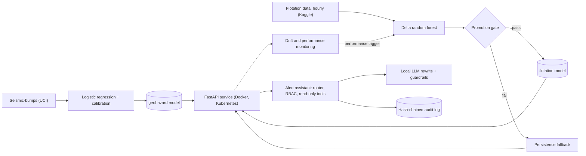

# Mine AI Platform

An end-to-end, reproducible machine-learning platform for a mining setting, built on two public datasets:
a **rockburst risk ranker** (seismic monitoring) and a **flotation silica forecaster** (process plant), with
containerised serving, Kubernetes manifests, CI, drift monitoring, an ONNX / TensorRT edge benchmark, and a
**governed alert assistant** (rule-routed tools, access control, audit log, local LLM behind guardrails).

The emphasis is on **honest evaluation**: time-aware splits, strong baselines, a promotion gate that blocks models
that do not clearly beat the baseline, and a write-up of what did not work.

> **Portfolio project on small public data. Not validated for operational or safety use.**

## What this demonstrates

| Area | What is in the repository |
|---|---|
| ML development | scikit-learn and PyTorch models, time-ordered evaluation, baselines, calibration, cost-sensitive alerting |
| MLOps | locked dependencies (`uv`), GitHub Actions CI that retrains from committed data, MLflow tracking, Docker image, Kubernetes manifests (tested on a local kind cluster), promotion gate, scheduled monitor-and-retrain workflow |
| Edge AI and performance | ONNX export with numerical parity check, ONNX Runtime CPU / CUDA, TensorRT FP16, latency benchmark across batch sizes |
| GenAI and governance | local LLM (Ollama) constrained by guardrails, role-based access control, hash-chained audit log, human-in-the-loop drafts, injection and failure regression tests, model card and governance notes |
| Industrial data | hourly process and lab data, frozen-sensor and stuck-value findings, drift and performance monitoring |

## Architecture



## Results at a glance

| Module | Result (time-ordered hold-out) | Reference |
|---|---|---|
| Rockburst risk ranking | PR-AUC 0.105, top-10% lift 0.19 (5 of 26 events) | random 0.034 / 0.10 |
| Rockburst alerts | 22 alerts, 3 of 26 events caught, cost 249 | "never alert" cost 260 |
| Flotation silica, sensors only | best hold-out R-squared 0.07 | repeat last lab value: 0.61 |
| Flotation silica, delta model | RMSE 0.680 vs 0.713 (4.6% better; 90% bootstrap interval 2.9% to 6.2%) | MAE about 4.6% worse |
| Neural variant (edge) | 2.1% better than baseline, **below the 3% gate, not deployed** | |
| Tests | 47 unit and integration tests, 19 assistant behaviour cases | |

Numbers come from single runs on small public data. See `docs/MODEL_CARD.md` and `docs/results/`.

## Key findings

1. **Random splits inflate results.** A random split raised a random forest's PR-AUC on the seismic data from 0.07 (time split) to 0.23, and
   similar leakage appeared in the flotation data (neighbouring hours, and using the iron concentrate as a feature). All reported results use time-ordered splits.
2. **The signal is weak and the honest conclusion is modest.** More complex models and lag features did not beat the simple model on the seismic data; process sensors alone
   have almost no skill on the flotation data. The delta model helps mainly around changes in the lab value (RMSE about 4.9% better on those hours) and adds a little noise otherwise.
3. **A promotion gate protects the service.** A model is released only if it beats the persistence baseline by at least 3% RMSE in cross-validation and on hold-out; otherwise
   the API serves the baseline and says so. The neural variant was blocked by this gate.
4. **Drift is not the same as retraining.** All 9 weekly windows of the flotation replay show input drift, yet the model still beat the baseline in 8 of 9 (mean improvement about 5.1%).
   Drift therefore triggers investigation; retraining is triggered by performance. For the rockburst model the mean alert rate was 3.1% against a 10% budget, which triggers a threshold recalibration recommendation.
5. **Industrial data quality matters.** Two air-flow sensors are frozen for long stretches (99% of March hours repeat the previous value), about a third of the reference-period hours have feed grades stuck at one constant,
   and feed grades update roughly every ten hours. These artifacts inflate measured drift (PSI up to about 9) and probably explain unstable linear models in early folds. They were documented, not removed.
6. **Small models do not need a GPU at the edge** (see below).
7. **A local LLM adds little value, and needs guardrails.** See "Alert assistant".

## Edge inference benchmark

Model exported to ONNX (preprocessing inside the graph; max difference to PyTorch 2.4e-7). Latency p50 in ms, numpy in and numpy out including host-device copies,
on a laptop RTX 3050 Ti under WSL2, one run (CPU latencies varied by up to about 2x between runs).

| Model | Batch | ORT CPU | ORT CUDA | ORT TensorRT FP16 | PyTorch CUDA |
|---|---|---|---|---|---|
| Trained MLP (about 30k parameters) | 1 | **0.015** | 0.169 | 0.171 | 0.352 |
| | 64 | **0.048** | 0.259 | 0.298 | 0.431 |
| | 1024 | 0.442 | **0.258** | 0.280 | 0.598 |
| | 8192 | 6.51 | 1.56 | **1.53** | 1.70 |
| Synthetic large MLP (random weights, latency only) | 1 | 0.545 | 0.341 | **0.334** | 0.713 |
| | 64 | 3.96 | 0.517 | **0.352** | 0.923 |
| | 1024 | 60.9 | 2.73 | **2.09** | 3.59 |
| | 8192 | 626 | 16.1 | **15.2** | 24.0 |

For a model of this size, ONNX Runtime on CPU is the right edge choice (about 15 microseconds at batch 1); GPUs and TensorRT pay off for larger models or large batches
(TensorRT FP16 was about 1.3 to 1.5x faster than the plain CUDA provider at mid batch sizes, with small numerical differences). A laptop GPU is not an edge device: trends are more reliable than absolute values.

## Alert assistant and governance

A **controlled tool-calling assistant**, not an autonomous agent: a rule-based router picks the tool, access control is checked before anything runs,
tools are read-only, and inspection orders are drafts that need human approval.

- The LLM never sees the user's message or unauthorised data. It only receives a deterministic template text and may rewrite it.
- A rewrite is used only if it keeps every number and caveat (including negations) and adds no numbers, risk labels, advice or reassurance; otherwise the template is shown.
- Every request, denial, tool call and LLM rejection goes to a hash-chained audit log (tampering is detectable).
- 19 scripted behaviour cases (role claims in the message, English and Chinese injection attempts, out-of-scope requests, bad parameters) all pass; two real LLM failures are kept as regression tests.

**What the LLM evaluation showed** (local model `qwen2.5:3b` via Ollama; 41 requests: 20 shifts split between the ELEVATED and ALERT bands, 20 forecast hours and 1 monitoring request): 21 of 41 rewrites (51%) passed all checks, and **all 21 were verbatim copies of the template, so none was a genuine rewrite**. All 20 flotation rewrites were rejected for the same reason: the model appended a stray "not" ("... treat it as a small correction not."), which changes the negation count (two also dropped a number). The model is deterministic at temperature 0, so this is a systematic failure, not noise. It may be induced by the rewrite prompt, which mentions negations; this was not tested. Before the semantic guard existed, the model produced text with correct numbers but wrong meaning (it invented "risk level is ALERT" for a forecast without a risk level, and wrote "acceptable parameters" next to "inspection is advised"). Conclusion: the deterministic template is the answer of record; in this setup the small local model adds no information, only risk, so the LLM is an optional, heavily checked extra.

See `docs/GOVERNANCE.md` for the controls implemented and the gaps that would remain in production.

## Repository layout

```
src/
  data.py, train.py                      rockburst model (training, calibration, alert budget)
  prepare_flotation.py                   20-second raw data -> hourly data
  train_flotation_final.py               flotation model with promotion gate (served model)
  flotation_features.py                  feature code shared by training and serving
  train_flotation.py, flotation_experiments.py, baselines.py   exploration scripts kept for reproducibility
  app.py                                 FastAPI service (both models, fallback, audit logging)
  drift.py, monitor_*.py                 PSI-based drift and performance monitoring, retrain/recalibrate rules
  edge_model.py, train_edge_nn.py, edge_benchmark.py   PyTorch variant, ONNX export, CPU/CUDA/TensorRT benchmark
  assistant/, assistant_cli.py, eval_assistant.py       governed assistant, CLI, evaluation
tests/        47 tests (API, skew, drift, assistant, guardrails)
eval/         assistant behaviour cases
k8s/          Deployment and Service manifests
scripts/      sample requests, local CI, edge environment helper
docs/         model card, governance notes, result snapshots and figures
.github/workflows/   CI and scheduled monitor-and-retrain
data/         small public datasets (see data/README.md for sources and licences)
```

## Quick start

Requirements: Python 3.12 and [uv](https://docs.astral.sh/uv/). Docker, kind and kubectl are optional.

```bash
git clone https://github.com/baiheng2012/mine-ai-platform.git && cd mine-ai-platform
uv sync --frozen
bash scripts/ci_pipeline.sh          # trains both models, generates samples, runs monitoring and the test suite
uv run python src/eval_assistant.py  # assistant behaviour evaluation (deterministic, no LLM needed)

# serve and call the API
uv run uvicorn app:app --app-dir src --port 8000
curl -s localhost:8000/health
curl -s -X POST localhost:8000/predict -H "Content-Type: application/json" -d @sample.json
curl -s -X POST localhost:8000/flotation/predict -H "Content-Type: application/json" -d @sample_flotation.json

# assistant (add --backend ollama if Ollama is running with a small instruct model)
uv run python src/assistant_cli.py --role operator "What is the rockburst risk for shift 2100?"
```

Container and Kubernetes (local kind cluster):

```bash
docker build -t geohazard-api:0.1 .
kind create cluster --name mine-ai
kind load docker-image geohazard-api:0.1 --name mine-ai
kubectl apply -f k8s/deployment.yaml && kubectl get pods
```

(The manifest references the image tag set in `k8s/deployment.yaml`; keep the two in sync.)

Edge benchmark (needs an NVIDIA GPU and extra packages; not installed by default):

```bash
uv sync --group edge
source scripts/edge_env.sh
uv run --group edge python src/train_edge_nn.py
uv run --group edge python src/edge_benchmark.py
```

## CI

`scripts/ci_pipeline.sh` is the single definition of the pipeline, used by GitHub Actions and by `scripts/ci_local.sh` (which reproduces CI in a clean clone).
It trains both models from the committed data, runs monitoring, the test suite and the assistant evaluation; the workflow then builds the Docker image.
`monitor-retrain.yml` runs weekly (and on demand): it monitors, and retrains through the promotion gate when the monitoring rule recommends it.
In this demo the data are static, so the retraining step shows the mechanism rather than producing a new model.

## Limitations and future work

- Small public datasets from two different plants; single time range; very few positive events (26 in the rockburst hold-out). No external validation.
- Thresholds, cost ratio, alert budget and the 3% gate are assumptions that operators would need to confirm. In the test segment 754 of 776 shifts (97%) fall in the rockburst "ELEVATED" band (score of at least half the alert threshold), 22 are "ALERT" and none is "NORMAL", so the middle band carries almost no information and the rule "no inspection draft for NORMAL risk" never triggers on this data; the bands should be redefined (for example by score quantiles) in a future version.
- The rockburst data are assumed to be in time order; this was not verified.
- Flotation data-quality artifacts (frozen sensors, stuck feed grades) were documented but not removed; a sensitivity study without those periods is future work.
- The assistant uses a role passed by the caller and a local log file; production needs real authentication, append-only audit storage and an approval workflow.
- Ideas not done: retraining on a rolling window, a sensor-health monitor, causal analysis before giving process advice, a model registry with approvals.

## Data and licences

Seismic-bumps (UCI, Sikora and Wrobel) and the flotation data (Kaggle, "Quality Prediction in a Mining Process", CC0) are described in `data/README.md`.
Code licence: MIT (see `LICENSE`).
